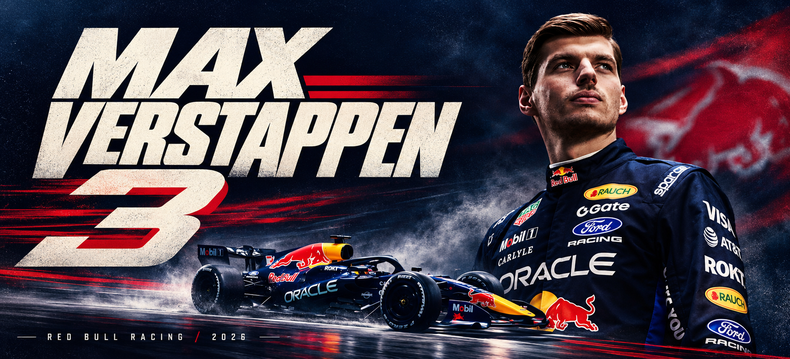

  

  <samp>FORMULA 1 &nbsp; / &nbsp; MAX VERSTAPPEN &nbsp; / &nbsp; #3</samp>

<!-- F1-TRACKER:START -->

## Max Verstappen / Season report

<picture>
  <source media="(max-width: 600px)" srcset="./assets/f1-max-mobile.svg?v=04286f181e5c" />
  
</picture>

**Last Grand Prix:** Mexico City Grand Prix · 2026-11-01 · **P1** · **+25 race points**.

### Drivers' standings · 2026

| # | Driver | Team | Points |
| --: | :-- | :-- | --: |
| 1 | Andrea Kimi Antonelli | Mercedes | 380 |
| **2** | **Max Verstappen** | **Red Bull** | **261** |
| 3 | Lewis Hamilton | Ferrari | 259 |
| 4 | George Russell | Mercedes | 250 |
| 5 | Charles Leclerc | Ferrari | 245 |

All drivers (24)

| # | Driver | Team | Points |
| --: | :-- | :-- | --: |
| 1 | Andrea Kimi Antonelli | Mercedes | 380 |
| **2** | **Max Verstappen** | **Red Bull** | **261** |
| 3 | Lewis Hamilton | Ferrari | 259 |
| 4 | George Russell | Mercedes | 250 |
| 5 | Charles Leclerc | Ferrari | 245 |
| 6 | Lando Norris | McLaren | 221 |
| 7 | Oscar Piastri | McLaren | 144 |
| 8 | Isack Hadjar | Red Bull | 107 |
| 9 | Liam Lawson | RB F1 Team / Red Bull | 83 |
| 10 | Pierre Gasly | Alpine F1 Team | 42 |
| 11 | Arvid Lindblad | RB F1 Team | 38 |
| 12 | Franco Colapinto | Alpine F1 Team | 27 |
| 13 | Oliver Bearman | Haas F1 Team | 23 |
| 14 | Gabriel Bortoleto | Audi | 14 |
| 15 | Nico Hülkenberg | Audi | 13 |
| 16 | Esteban Ocon | Haas F1 Team | 7 |
| 17 | Fernando Alonso | Aston Martin | 7 |
| 18 | Carlos Sainz | Williams | 7 |
| 19 | Alexander Albon | Williams | 5 |
| 20 | Yuki Tsunoda | RB F1 Team | 1 |
| 21 | Ryo Hirakawa | Haas F1 Team | 1 |
| 22 | Lance Stroll | Aston Martin | 0 |
| 23 | Valtteri Bottas | Cadillac F1 Team | 0 |
| 24 | Sergio Pérez | Cadillac F1 Team | 0 |

Standings after Round 19. Last data change: 2026-11-02 20:22 UTC. Checked every 30 minutes. Standings update after results are published; updates may be delayed.

Source: [Jolpica F1](https://api.jolpi.ca/ergast/f1/2026/driverstandings.json) · [CC BY-NC-SA 4.0](https://creativecommons.org/licenses/by-nc-sa/4.0/) · [Official F1 standings](https://www.formula1.com/en/results/2026/drivers) · [Update status](https://github.com/TheLegendaryLord/TheLegendaryLord/actions/workflows/f1-tracker.yml)

<!-- F1-TRACKER:END -->

  <b>2021 &nbsp;·&nbsp; 2022 &nbsp;·&nbsp; 2023 &nbsp;·&nbsp; 2024</b> 
  WORLD CHAMPIONSHIPS

 

  <a href="https://github.com/TheLegendaryLord?tab=repositories">Repositories</a>
  &nbsp; / &nbsp;
  <a href="https://github.com/TheLegendaryLord?tab=stars">Stars</a>
  &nbsp; / &nbsp;
  <a href="https://www.formula1.com/en/drivers/max-verstappen">Max on F1</a>

  TheLegendaryLord · unofficial fan profile

Artwork & sources

Original AI-generated fan artwork, based on the 2026 [Max Verstappen portrait](https://www.redbullracing.com/int-en/drivers/max-verstappen/) from Oracle Red Bull Racing and an [RB22 reference photo](https://media.formula1.com/image/upload/t_16by9Centre/c_lfill%2Cw_3392/q_auto/v1740000000/fom-website/2026/Red%20Bull/display%20SI202601250301.webp) published by Formula 1. Source photographs belong to their respective rights holders.

[Racing number 3 for 2026 — Formula 1](https://www.formula1.com/en/latest/article/max-verstappen-confirms-he-will-use-car-number-3-for-2026-season.6qvN2SQwcyGYnMWhGdDpNS) · [Driver profile and championship record — Formula 1](https://www.formula1.com/en/drivers/max-verstappen)

